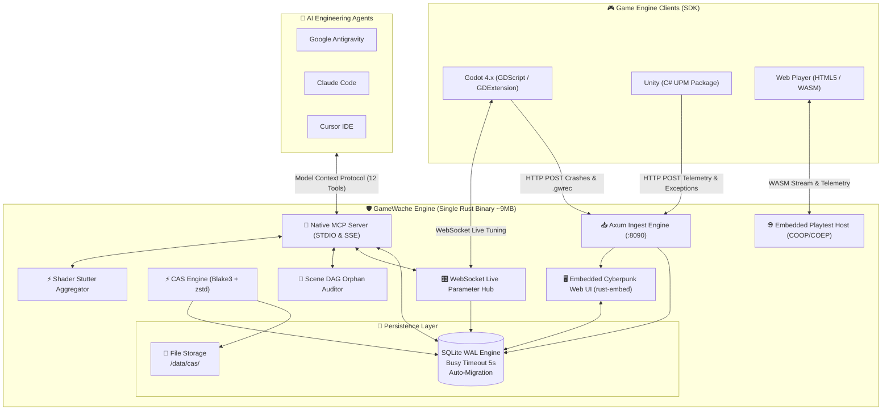

# 🎮 GameWache

<p align="center">
  🌐 <strong>Languages:</strong>
  <a href="README.md"><strong>🇬🇧 English</strong></a> •
  <a href="README.pl.md">🇵🇱 Polski</a> •
  <a href="README.de.md">🇩🇪 Deutsch</a> •
  <a href="README.es.md">🇪🇸 Español</a> •
  <a href="README.fr.md">🇫🇷 Français</a>
</p>

<p align="center">
  <strong>Autonomous GameOps Engine for Game Developers: Crash Sentinel, Deterministic Blackbox Replay, Remote Asset Cache (CAS), Live Parameter Tweaker & Native AI MCP Server in a single Rust binary.</strong><br>
  <em>A fusion of Nachtwache (observability, zero dependencies, crash diagnostics) and Blitzrunner (CI optimization, smart diff pruning, bare-metal acceleration) purpose-built for modern game engines (Godot 4, Unity, Unreal, Custom).</em>
</p>

<p align="center">
  <a href="LICENSE"></a>
  
  
  
  
  <a href="https://buymeacoffee.com/adrianwulf"></a>
  <a href="https://github.com/sponsors/adrian-wulf"></a>
</p>

<p align="center">
  
  
  
  
  
  
  
</p>

---

## 📑 Table of Contents
1. [⚡ Why GameWache?](#-why-gamewache)
2. [🌐 Adrian Wulf Ecosystem](#-adrian-wulf-ecosystem)
3. [📊 Comparison: Traditional Tools vs GameWache](#-comparison-traditional-tools-vs-gamewache)
4. [🏗️ System Architecture](#️-system-architecture)
5. [🚀 Quick Start](#-quick-start)
6. [🤖 AI Agent Integration (Native MCP Server)](#-ai-agent-integration-native-mcp-server)
7. [📼 Deterministic Blackbox Input Replay (.gwrec)](#-deterministic-blackbox-input-replay-gwrec)
8. [⚡ Remote Asset Cache (CAS) & CI Smart Prune](#-remote-asset-cache-cas--ci-smart-prune)
9. [🎛️ Live WebSocket Parameter Tweaker](#️-live-websocket-parameter-tweaker)
10. [⚡ Shader Stutter Tracker & Pre-warm Generator](#-shader-stutter-tracker--pre-warm-generator)
11. [🧹 Orphan Asset Hunter & Memory Budget Enforcement](#-orphan-asset-hunter--memory-budget-enforcement)
12. [🎮 Engine Integration (Godot 4 & Unity SDK)](#-engine-integration-godot-4--unity-sdk)
13. [🌐 WASM / HTML5 Private Playtest Hosting](#-wasm--html5-private-playtest-hosting)
14. [🐳 Production Deployment (Docker & Coolify)](#-production-deployment-docker--coolify)
15. [☕ Support the Project & RobinHood dev](#-support-the-project--robinhood-dev)
16. [⚖️ Impressum & Legal Notice (§ 5 DDG / MIT)](#️-impressum--legal-notice--5-ddg--mit)

---

## ⚡ Why GameWache?

Traditional observability platforms and web-centric CI tools fail in game development:

1. **Web crash reporters (Sentry, BugSplat) lack game context**: A standard stack trace like `NullReferenceException` doesn't tell you the physics tick, current game state, controller input sequence, FPS drops, or spatial `(x, y, z)` level coordinates where the crash happened.
2. **The Reproduction Nightmare**: When a player reports *"Game crashed during boss fight"*, developers spend days guessing. GameWache provides a zero-overhead (<0.02ms/frame) circular **Blackbox Input Replay**, capturing the last 30–60 seconds of player inputs to reproduce crashes frame-by-frame directly in Godot or Unity editor.
3. **Game CI is absurdly slow and expensive**: Compiling shaders, importing multi-gigabyte texture arrays (ASTC/BC7), and baking asset bundles takes 30–90 minutes on fresh CI runners. GameWache integrates a **Remote Content Addressable Cache (CAS)** powered by **Blake3** (>5 GB/s hashing) and **zstd** compression, alongside a **Game CI Smart Prune** filter that skips asset pipelines when only code changed.
4. **AI-Driven Game Engineering**: With a built-in **Model Context Protocol (MCP)** server, coding agents (Google Antigravity, Claude Code, Cursor) can query crash telemetry, inspect blackbox input replays, tweak physics constants live via WebSocket, audit asset DAGs, and trigger headless gut/unit tests.

---

## 🌐 Adrian Wulf Ecosystem

GameWache is an integral part of an independent suite of developer and business tools built under the **RobinHood dev** philosophy:

| Service / Project | Live URL | Purpose |
| :--- | :---: | :--- |
| 🎮 **GameWache** | [github.com/adrian-wulf/gamewache](https://github.com/adrian-wulf/gamewache) | **Autonomous GameOps Engine:** Crash Sentinel, Blackbox Replay, Remote CAS, and AI MCP Server. |
| 🛡️ **Nachtwache** | [sentry.social-wulf.eu](https://sentry.social-wulf.eu) | **Autonomous Error Tracker & Sentry Replacement:** Single Rust binary, ~15 MB RAM, SQLite WAL, and built-in AI Auto-Fix ([GitHub](https://github.com/adrian-wulf/nachtwache)). |
| ⚡ **BlitzRunner** | [github.com/adrian-wulf/blitzrunner](https://github.com/adrian-wulf/blitzrunner) | **Zero-Server CI Optimizer & Ephemeral Bare-Metal Runner:** Cuts CI costs by 90% and accelerates builds 4x on disposable cloud compute. |
| 🚀 **Wulf Lead.er** | [lead.social-wulf.eu](https://lead.social-wulf.eu) | **B2B Lead Intelligence Radar & Web Auditor:** Local prospecting via OpenStreetMap, technical audits (SSL, TTFB, RWD), and Gemini OSINT ([GitHub](https://github.com/adrian-wulf/wulf-lead-er)). |
| 🌐 **Central Wulf Hub** | [social-wulf.eu](https://social-wulf.eu) | **Main Ecosystem Showcase:** Technology portfolio and developer sovereignty portal by Adrian Wulf. |
| 💼 **Wulf Code** | [wulf-code.it](https://wulf-code.it) | **Software House & Consulting:** High-performance infrastructure, game systems, and security audits. |

---

## 📊 Comparison: Traditional Tools vs GameWache

| Feature / Metric | Sentry (SaaS / Self-Hosted) | GameAnalytics | Unity Accelerator | 🎮 **GameWache** (Adrian Wulf) |
| :--- | :---: | :---: | :---: | :---: |
| **Architecture** | 20+ containers (16–32 GB RAM) | Cloud SaaS | Dedicated server | **1 single Rust binary (~9 MB, ~25 MB RAM)** |
| **Database** | Postgres + ClickHouse + Kafka | Closed Cloud | Proprietary cache | **Native SQLite WAL (Zero setup, auto-migrate)** |
| **Blackbox Input Replay** | ❌ None | ❌ None | ❌ None | **✅ 30–60s circular buffer (.gwrec), tick-perfect** |
| **Spatial 2D/3D Heatmaps** | ❌ None | ⚠️ Paid Enterprise | ❌ None | **✅ Built-in Canvas 2D/3D crash & death maps** |
| **Remote Asset Cache (CAS)** | ❌ None | ❌ None | $185+/seat/month | **✅ Built-in Blake3 + zstd CAS Cache** |
| **CI Smart Prune for Games** | ❌ None | ❌ None | ❌ None | **✅ Skips redundant asset re-imports on code-only PRs** |
| **Shader Hitch Pre-warm** | ❌ None | ❌ None | ❌ None | **✅ Hitch detection + GDScript/C# pre-warm generator** |
| **Live WebSocket Tuning** | ❌ None | ❌ None | ❌ None | **✅ Real-time slider tweaking in live game** |
| **Orphan Asset Hunter** | ❌ None | ❌ None | ❌ None | **✅ Scene DAG crawler finds unused textures & audio** |
| **Private WASM Playtest Host** | ❌ None | ❌ None | ❌ None | **✅ Embedded Web server with COOP/COEP headers** |
| **Built-in AI Protocol** | ❌ None | ❌ None | ❌ None | **✅ Native Model Context Protocol (MCP) server** |
| **License & Pricing** | FSL / BSL / Expensive SaaS | Free with data telemetry | Expensive Enterprise | **100% Free MIT License (Self-hosted sovereignty)** |

---

## 🏗️ System Architecture

GameWache is designed for maximum speed, zero background maintenance, and minimal resource usage:



---

## 🚀 Quick Start

### 1. Build from Source
```bash
# Clone repository
git clone https://github.com/adrian-wulf/gamewache.git
cd gamewache

# Compile release binary
cargo build --release

# Run GameOps Server (Web Dashboard at http://localhost:8090)
./target/release/gamewache serve --port 8090
```

### 2. Universal MCP Server for AI Agents
No complex arguments required. GameWache automatically resolves your active Godot (`project.godot`) or Unity project from the current working directory:
```bash
./target/release/gamewache mcp
```

### 3. CLI Subcommands
```bash
# Audit orphan assets in your game project
./target/release/gamewache audit --project-dir /path/to/game --max-texture-mb 16

# Generate shader pre-warm script from recorded pipeline hitches
./target/release/gamewache prewarm --project-id my-game --engine godot

# Upload or download assets from CAS remote cache
./target/release/gamewache cache put my_bundle.pck --server http://localhost:8090
./target/release/gamewache cache get <blake3_hash> --output my_bundle.pck
```

---

## 🤖 AI Agent Integration (Native MCP Server)

GameWache ships with a first-class **Model Context Protocol (MCP)** server, transforming AI assistants like **Google Antigravity**, **Cursor**, and **Claude Code** into active members of your game development team.

Configure your editor or agent (`claude_desktop_config.json`, Antigravity `mcp_servers`, or Cursor MCP settings):

```json
{
  "mcpServers": {
    "gamewache": {
      "command": "/usr/local/bin/gamewache",
      "args": ["mcp"]
    }
  }
}
```

### Available MCP Tools (12 Native Capabilities):
1. **`gw_query_crashes`**: Search crashes with filters for engine, version, severity, and time range.
2. **`gw_get_crash_details`**: Retrieve full stack trace, breadcrumb trail, and system hardware specifications.
3. **`gw_inspect_replay`**: Inspect player inputs tick-by-tick leading up to an incident.
4. **`gw_spatial_hotspots`**: Fetch aggregated coordinate clusters where players crash or die.
5. **`gw_tweak_runtime_var`**: Dynamically change a variable in the live running game via WebSocket.
6. **`gw_exec_console_cmd`**: Run console commands inside the running game instance.
7. **`gw_audit_assets`**: Run dependency DAG crawls to detect unreferenced assets and budget overruns.
8. **`gw_generate_shader_prewarm`**: Produce drop-in GDScript or C# shader warm-up scripts.
9. **`gw_run_headless_tests`**: Execute Godot GUT or Unity UTF tests headlessly and return parsed diagnostics.
10. **`gw_deploy_web_playtest`**: Spin up an isolated HTML5/WASM playtest deployment with a shareable URL.
11. **`gw_query_feedback`**: Review player bug reports, user notes, and embedded replay recordings.
12. **`gw_cas_stat`**: Inspect remote cache size, hit ratios, and storage efficiency.

---

## 📼 Deterministic Blackbox Input Replay (.gwrec)

Reproducing complex gameplay bugs is traditionally painful. GameWache's circular memory buffer stores the player's last 30–60 seconds of inputs:

* **RAM Footprint**: ~180 KB for 60 seconds at 60 physics FPS.
* **CPU Overhead**: Under **0.02 ms** per physics tick (fixed struct ring buffer, zero heap allocations).
* **Frame-Accurate Scrubbing**: The Web UI dashboard contains an embedded timeline scrubber allowing you to inspect every axis movement, button press, and mouse delta.
* **In-Editor Playback**: Drop the exported `.gwrec` file into Godot or Unity and re-run the exact sequence in the native editor debugger!

---

## ⚡ Remote Asset Cache (CAS) & CI Smart Prune

Game CI builds are notoriously slow due to repetitive asset compilation. GameWache resolves this with a dual-layer acceleration:

1. **Content Addressable Storage (CAS)**:
   * **Blake3** hashing at **>5 GB/s** ensures instantaneous cache lookups.
   * **zstd** stream compression minimizes network transfer and disk usage.
   * Compatible with Godot `.pck` files, Unity AssetBundles, and raw audio/texture files.

2. **Smart Prune GitHub Action (`actions/smart-prune`)**:
   * Inspects `git diff` on incoming PRs in ~2 seconds.
   * Skips asset re-import and texture compression stages when changes only affect scripts (`.gd`, `.cs`, `.rs`, `.md`).
   * Saves up to **80% of CI minutes** on typical code-only pull requests.

---

## 🎛️ Live WebSocket Parameter Tweaker

Tune gameplay mechanics on the fly without stopping and restarting the game:

1. **Register a variable in your game script**:
   ```gdscript
   # Godot 4 (GDScript)
   GameWache.register_tweak("Player/MoveSpeed", self, "speed", {"min": 100.0, "max": 1000.0})
   GameWache.register_tweak("Weapon/RecoilDamping", self, "recoil_damping", {"min": 0.0, "max": 1.0})
   ```
2. **Adjust from Browser or AI Chat**:
   * Drag sliders in the GameWache Web UI at `http://localhost:8090`.
   * Or instruct your AI agent: *"Tweak tank turret rotation speed up by 25% and test how responsive it feels."*

---

## ⚡ Shader Stutter Tracker & Pre-warm Generator

Pipeline State Object (PSO) hitches are the number one cause of stutter in modern game engines. GameWache automatically identifies shader hitches:

1. The SDK reports any frame where compile time exceeded 33 ms (dropped frames).
2. The server aggregates hitches across player sessions and logs the material and shader paths.
3. Run the generator to output an engine-ready pre-warm script:
   ```bash
   gamewache prewarm --project-id panzer-game --engine godot
   ```
4. The generated `shader_prewarm.gd` instantiates and compiles all hitches offscreen during your game's splash screen.

---

## 🧹 Orphan Asset Hunter & Memory Budget Enforcement

Avoid shipping bloated installer binaries by identifying unreferenced assets:

```bash
gamewache audit --project-dir ./my_game --max-texture-mb 16 --max-audio-mb 10
```

* Scans scene files (`.tscn`, `.unity`) and resource dependencies to build a reachability Directed Acyclic Graph (DAG).
* Warns if unreferenced files are occupying disk space.
* Flags individual textures or uncompressed WAV audio violating defined memory budgets.

---

## 🎮 Engine Integration (Godot 4 & Unity SDK)

### Godot 4.x (GDScript)
1. Copy `sdks/godot/addons/gamewache` to your project's `addons/` directory.
2. Enable the plugin under `Project -> Project Settings -> Plugins -> GameWache`.
3. Press **F11** in-game to trigger the player feedback & crash recording overlay.

### Unity (C#)
1. Open the Package Manager and select **Add package from disk...**.
2. Select `sdks/unity/package.json`.
3. Attach the `GameWacheClient` component to your root initialization GameObject.

---

## 🌐 WASM / HTML5 Private Playtest Hosting

GameWache includes an integrated static web server optimized for HTML5 and WebAssembly game exports:
* Automatically serves required HTTP headers for `SharedArrayBuffer` support (`Cross-Origin-Opener-Policy: same-origin` and `Cross-Origin-Embedder-Policy: require-corp`).
* Tokenized playtest URLs with password or expiration limits for external testers.

---

## 🐳 Production Deployment (Docker & Coolify)

Deploy GameWache in seconds using Docker Compose:

```bash
docker compose up -d
```

### `docker-compose.yml`
```yaml
services:
  gamewache:
    image: ghcr.io/adrian-wulf/gamewache:latest
    build: .
    restart: unless-stopped
    ports:
      - "8090:8090"
    volumes:
      - gamewache_data:/data
    environment:
      - GAMEWACHE_PORT=8090
      - GAMEWACHE_DATA_DIR=/data

volumes:
  gamewache_data:
```

### Reverse Proxy (Caddy with automatic SSL)
```caddy
gamewache.your-studio.com {
    reverse_proxy 127.0.0.1:8090
}
```

---

## ☕ Support the Project & RobinHood dev

<p align="center">
  <a href="https://buymeacoffee.com/adrianwulf"></a>
  <a href="https://github.com/sponsors/adrian-wulf"></a>
</p>

### What is the RobinHood dev philosophy?
> **"Studio-grade GameOps, crash diagnostics, and CI infrastructure should be accessible to every indie game creator, not a luxury reserved for multi-million-dollar publishers."**

Game development is already high-risk and grueling. Indie teams shouldn't be penalized with monthly per-seat SaaS bills for crash tracking and asset caching.

**GameWache is 100% Free and Open Source under the MIT License.** Zero telemetry, zero feature paywalls, and zero cloud vendor lock-in.

### How to support:
* ☕ **Buy Me a Coffee:** [buymeacoffee.com/adrianwulf](https://buymeacoffee.com/adrianwulf)
* 💖 **Sponsor on GitHub:** [github.com/sponsors/adrian-wulf](https://github.com/sponsors/adrian-wulf)
* ⭐ **Star the Repository:** Help other game developers discover GameWache.
* 🛠️ **Contribute Code & SDKs:** PRs for Unreal Engine, Bevy, and Defold are warmly welcomed!

---

## ⚖️ Impressum & Legal Notice (§ 5 DDG / MIT)

### Information pursuant to § 5 German Digital Services Act (DDG):
* **Developer / Author:** Adrian Wulf
* **Contact:** Available via GitHub: [https://github.com/adrian-wulf](https://github.com/adrian-wulf) and portal [https://social-wulf.eu](https://social-wulf.eu) / [https://wulf-code.it](https://wulf-code.it).

### Disclaimer & MIT License:
GameWache is distributed under the **MIT License**. The software is provided "AS IS", without warranty of any kind, express or implied. See [LICENSE](LICENSE) for full details.

### Trademark Notice:
* **Godot Engine** is a registered trademark of the Godot Foundation.
* **Unity** is a registered trademark of Unity Technologies.
* **Sentry** is a registered trademark of Functional Software, Inc.  
GameWache is an independent open-source project and is not affiliated with, endorsed by, or sponsored by these entities.

---

<p align="center">
  <em>Crafted with passion for independent game developers worldwide by Adrian Wulf.</em>
</p>
