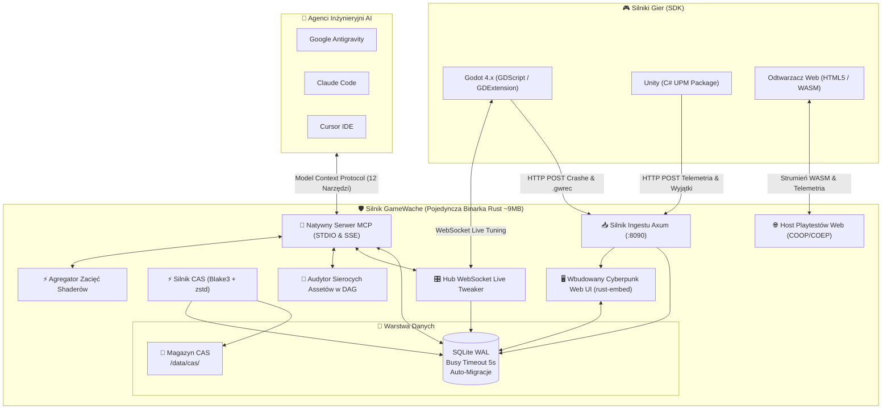

# 🎮 GameWache

<p align="center">
  🌐 <strong>Języki / Languages:</strong>
  <a href="README.md">🇬🇧 English</a> •
  <a href="README.pl.md"><strong>🇵🇱 Polski</strong></a> •
  <a href="README.de.md">🇩🇪 Deutsch</a> •
  <a href="README.es.md">🇪🇸 Español</a> •
  <a href="README.fr.md">🇫🇷 Français</a>
</p>

<p align="center">
  <strong>Autonomiczny silnik GameOps dla twórców gier: strażnik awarii, czarna skrzynka wejść (Blackbox Replay), zdalny cache assetów (CAS), strojenie parametrów na żywo i wbudowany serwer MCP dla AI w pojedynczej binarce Rust.</strong><br>
  <em>Fuzja filozofii Nachtwache (obserwowalność, zero zależności, diagnostyka awarii) i Blitzrunner (optymalizacja CI, inteligentne pomijanie buildów, akceleracja bare-metal) stworzona specjalnie dla silników gier (Godot 4, Unity, Unreal, Custom).</em>
</p>

<p align="center">
  <a href="LICENSE"></a>
  
  
  
  
  <a href="https://buymeacoffee.com/adrianwulf"></a>
  <a href="https://github.com/sponsors/adrian-wulf"></a>
</p>

<p align="center">
  
  
  
  
  
  
  
</p>

---

## 📑 Spis Treści
1. [⚡ Dlaczego GameWache?](#-dlaczego-gamewache)
2. [🌐 Ekosystem Adriana Wulfa](#-ekosystem-adriana-wulfa)
3. [📊 Porównanie: Tradycyjne Narzędzia vs GameWache](#-porównanie-tradycyjne-narzędzia-vs-gamewache)
4. [🏗️ Architektura Systemu](#️-architektura-systemu)
5. [🚀 Szybki Start](#-szybki-start)
6. [🤖 Integracja z Agentami AI (Natywny MCP Server)](#-integracja-z-agentami-ai-natywny-mcp-server)
7. [📼 Czarna Skrzynka: Deterministyczny Blackbox Replay (.gwrec)](#-czarna-skrzynka-deterministyczny-blackbox-replay-gwrec)
8. [⚡ Zdalny Cache Assetów (CAS) & Smart Prune w CI](#-zdalny-cache-assetów-cas--smart-prune-w-ci)
9. [🎛️ Live WebSocket Parameter Tweaker](#️-live-websocket-parameter-tweaker)
10. [⚡ Shader Stutter Tracker & Pre-warm Generator](#-shader-stutter-tracker--pre-warm-generator)
11. [🧹 Orphan Asset Hunter & Strażnik Budżetów Pamięci](#-orphan-asset-hunter--strażnik-budżetów-pamięci)
12. [🎮 Podłączenie Silnika (Godot 4 & Unity SDK)](#-podłączenie-silnika-godot-4--unity-sdk)
13. [🌐 Prywatny Hosting Playtestów WASM / HTML5](#-prywatny-hosting-playtestów-wasm--html5)
14. [🐳 Wdrożenie Produkcyjne (Docker & Coolify)](#-wdrożenie-produkcyjne-docker--coolify)
15. [☕ Wsparcie Projektu & RobinHood dev](#-wsparcie-projektu--robinhood-dev)
16. [⚖️ Impressum & Nota Prawna (§ 5 DDG / MIT)](#️-impressum--nota-prawna--5-ddg--mit)

---

## ⚡ Dlaczego GameWache?

Klasyczne narzędzia analityczne i chmurowe platformy CI zawodzą w realiach tworzenia gier:

1. **Raportowanie błędów webowych (Sentry, BugSplat) nie rozumie gier**: Zwykły zrzut stosu `NullReferenceException` nie informuje o ticku fizyki, stanie maszyny stanów gry, sekwencji klawiszy pada, spadkach FPS ani koordynatach przestrzennych `(x, y, z)` na mapie poziomu, w których wystąpił błąd.
2. **Koszmar reprodukcji błędów**: Gdy tester zgłasza *"Gra wywaliła się na walce z bossem"*, programista traci dni na zgadywanie. GameWache zapewnia bufor kołowy **Blackbox Replay** o zerowym narzucie (<0.02ms/klatkę), rejestrujący ostatnie 30–60 sekund wejść gracza, co pozwala odtworzyć awarię klatka po klatce w edytorze Godot lub Unity.
3. **CI gier jest absurdalnie wolne i drogie**: Kompilacja shaderów, importowanie gigabajtów tekstur (ASTC/BC7) i pieczenie paczek trwa 30–90 minut na czystych maszynach CI. GameWache integruje **Remote Content Addressable Storage (CAS)** napędzany przez **Blake3** (>5 GB/s) i **zstd**, a także filtr **Smart Prune**, który pomija ponowny import assetów, gdy zmieniono wyłącznie kod.
4. **Programowanie gier wspomagane przez AI**: Dzięki wbudowanemu serwerowi **Model Context Protocol (MCP)**, asystenci programistyczni (Google Antigravity, Claude Code, Cursor) mogą badać crashe, analizować powtórki ruchów gracza, na żywo dostrajać balans fizyki przez WebSocket i uruchamiać testy headless.

---

## 🌐 Ekosystem Adriana Wulfa

GameWache jest częścią rodziny niezależnych narzędzi inżynieryjnych tworzonych w duchu **RobinHood dev**:

| Usługa / Projekt | Live URL | Przeznaczenie |
| :--- | :---: | :--- |
| 🎮 **GameWache** | [github.com/adrian-wulf/gamewache](https://github.com/adrian-wulf/gamewache) | **Autonomiczny GameOps Engine:** Crash Sentinel, Replay Blackbox, Remote CAS i AI MCP Server. |
| 🛡️ **Nachtwache** | [sentry.social-wulf.eu](https://sentry.social-wulf.eu) | **Lekki strażnik błędów:** Drop-in Sentry w pojedynczej binarce Rust (~15 MB RAM) z AI Auto-Fix ([GitHub](https://github.com/adrian-wulf/nachtwache)). |
| ⚡ **BlitzRunner** | [github.com/adrian-wulf/blitzrunner](https://github.com/adrian-wulf/blitzrunner) | **Optymalizator CI Zero-Server:** Analiza git diff i akceleracja buildów na Hetzner Bare-Metal. |
| 🚀 **Wulf Lead.er** | [lead.social-wulf.eu](https://lead.social-wulf.eu) | **Radar B2B Lead Intelligence & Audytor WWW:** Prospekcja przez OpenStreetMap, audyty SSL/TTFB i Gemini OSINT ([GitHub](https://github.com/adrian-wulf/wulf-lead-er)). |
| 🌐 **Central Wulf Hub** | [social-wulf.eu](https://social-wulf.eu) | **Główny portal ekosystemu:** Portfolio projektów i centrum suwerenności programistycznej. |
| 💼 **Wulf Code** | [wulf-code.it](https://wulf-code.it) | **Software House & Consulting:** Architektura systemów wysokiej wydajności i audyty bezpieczeństwa. |

---

## 📊 Porównanie: Tradycyjne Narzędzia vs GameWache

| Cecha / Funkcja | Sentry (SaaS / Self-Hosted) | GameAnalytics | Unity Accelerator | 🎮 **GameWache** (Adrian Wulf) |
| :--- | :---: | :---: | :---: | :---: |
| **Architektura** | 20+ kontenerów (16–32 GB RAM) | Chmura SaaS | Dedykowany serwer | **1 binarka Rust (~9 MB, ~25 MB RAM)** |
| **Baza Danych** | Postgres + ClickHouse + Kafka | Zamknięta chmura | Własnościowy cache | **Natywne SQLite WAL (Zero konfiguracji, auto-migracje)** |
| **Blackbox Input Replay** | ❌ Brak | ❌ Brak | ❌ Brak | **✅ Bufor kołowy 30–60s (.gwrec), tick-perfect** |
| **Mapy Przestrzenne 2D/3D** | ❌ Brak | ⚠️ Płatne Enterprise | ❌ Brak | **✅ Wbudowane mapy ciepła awarii i zgonów na Canvasie** |
| **Zdalny Cache Assetów (CAS)**| ❌ Brak | ❌ Brak | $185+ / stanowisko / mc | **✅ Wbudowany CAS Blake3 + zstd** |
| **Smart Prune dla Gier w CI** | ❌ Brak | ❌ Brak | ❌ Brak | **✅ Pomijanie importu assetów przy zmianach w kodzie** |
| **Shader Stutter Pre-warm** | ❌ Brak | ❌ Brak | ❌ Brak | **✅ Rejestracja hitchy + generator GDScript/C#** |
| **Live Tuning (WebSocket)** | ❌ Brak | ❌ Brak | ❌ Brak | **✅ Zmiana suwakami parametrów w działającej grze** |
| **Orphan Asset Hunter** | ❌ Brak | ❌ Brak | ❌ Brak | **✅ Wyszukiwanie nieużywanych tekstur i audio w DAG** |
| **Prywatny Host WASM** | ❌ Brak | ❌ Brak | ❌ Brak | **✅ Wbudowany serwer Web ze wsparciem COOP/COEP** |
| **Wbudowany Protokół AI** | ❌ Brak | ❌ Brak | ❌ Brak | **✅ Natywny serwer Model Context Protocol (MCP)** |
| **Koszt Licencji** | FSL / BSL / Drogie SaaS | Monetyzacja danymi | Drogie Enterprise | **100% Wolny Kod MIT (Zero opłat licencyjnych)** |

---

## 🏗️ Architektura Systemu

GameWache stawia na minimalizm, bezkompromisową wydajność i natychmiastowy czas odpowiedzi:



---

## 🚀 Szybki Start

### 1. Kompilacja ze źródeł
```bash
# Sklonuj repozytorium
git clone https://github.com/adrian-wulf/gamewache.git
cd gamewache

# Zbuduj zoptymalizowaną binarkę
cargo build --release

# Uruchom serwer GameOps (Panel Web pod adresem http://localhost:8090)
./target/release/gamewache serve --port 8090
```

### 2. Uniwersalny Serwer MCP dla Agentów AI
Brak konieczności konfigurowania skomplikowanych ścieżek! GameWache automatycznie wykrywa aktywny projekt Godot (`project.godot`) lub Unity na podstawie bieżącego katalogu roboczego:
```bash
./target/release/gamewache mcp
```

### 3. Polecenia CLI
```bash
# Audyt niepowiązanych assetów i przekroczeń budżetów pamięci
./target/release/gamewache audit --project-dir /sciezka/do/gry --max-texture-mb 16

# Wygeneruj skrypt rozgrzewający shadery na podstawie zarejestrowanych hitchy
./target/release/gamewache prewarm --project-id moja-gra --engine godot

# Prześlij lub pobierz paczki z cache CAS
./target/release/gamewache cache put moja_paczka.pck --server http://localhost:8090
./target/release/gamewache cache get <hash_blake3> --output moja_paczka.pck
```

---

## 🤖 Integracja z Agentami AI (Natywny MCP Server)

GameWache posiada pierwszorzędne wsparcie dla **Model Context Protocol (MCP)**, co czyni asystentów takich jak **Google Antigravity**, **Cursor** czy **Claude Code** pełnoprawnymi inżynierami w Twoim zespole gamedev.

Skonfiguruj klienta MCP (`claude_desktop_config.json`, ustawienia MCP w Cursorze lub Antigravity):

```json
{
  "mcpServers": {
    "gamewache": {
      "command": "/usr/local/bin/gamewache",
      "args": ["mcp"]
    }
  }
}
```

### 12 Dostępnych Narzędzi MCP:
1. **`gw_query_crashes`**: Przeszukiwanie awarii z filtrami silnika, wersji, wagi i czasu.
2. **`gw_get_crash_details`**: Pobranie pełnego zrzutu awarii, śladu breadcrumbs i specyfikacji sprzętu.
3. **`gw_inspect_replay`**: Analiza klatka po klatce wejść gracza prowadzących do błędu.
4. **`gw_spatial_hotspots`**: Grupowanie współrzędnych przestrzennych awarii lub zgonów.
5. **`gw_tweak_runtime_var`**: Zmiana zmiennej w działającej grze w czasie rzeczywistym przez WebSocket.
6. **`gw_exec_console_cmd`**: Wywołanie komendy w konsoli działającej instancji gry.
7. **`gw_audit_assets`**: Analiza grafu zależności pod kątem nieużywanych plików i limitów VRAM.
8. **`gw_generate_shader_prewarm`**: Generowanie gotowych skryptów pre-warm dla GDScript lub C#.
9. **`gw_run_headless_tests`**: Uruchomienie testów jednostkowych (GUT/UTF) w trybie headless z analizą wyników.
10. **`gw_deploy_web_playtest`**: Publikacja buildu HTML5/WASM z linkiem tokenizowanym dla testerów.
11. **`gw_query_feedback`**: Przegląd zgłoszeń błędów od graczy wraz z dołączonymi powtórkami.
12. **`gw_cas_stat`**: Statystyki trafień cache, oszczędności transferu i rozmiaru CAS.

---

## 📼 Czarna Skrzynka: Deterministyczny Blackbox Replay (.gwrec)

Odtwarzanie rzadkich błędów w grach sieciowych i singleplayerowych:
* **Pamięć RAM**: Zaledwie ~180 KB na 60 sekund historii rozgrywki w 60 FPS fizyki.
* **Narzut CPU**: Poniżej **0.02 ms** na klatkę (bufor kołowy o stałym rozmiarze, zero alokacji na stercie).
* **Odtwarzanie klatka po klatce**: Wbudowany scrubber w panelu Web pozwala obejrzeć każdy ruch analogów i wciśnięcie przycisku.
* **Debug w silniku**: Wrzuć plik `.gwrec` do edytora Godot lub Unity i odtwórz sytuację klatka po klatce z pełnym podglądem zmiennych!

---

## ⚡ Zdalny Cache Assetów (CAS) & Smart Prune w CI

Dwustopniowa akceleracja pipeline'u CI dla gier:

1. **Content Addressable Storage (CAS)**:
   * Haszowanie **Blake3** z prędkością **>5 GB/s** zapewnia natychmiastowe sprawdzanie obecności w cache.
   * Kompresja strumieniowa **zstd** minimalizuje ruch sieciowy i zużycie dysku.
   * Obsługa paczek Godot `.pck`, Unity AssetBundles oraz surowych assetów.

2. **Akcja GitHub Actions Smart Prune (`actions/smart-prune`)**:
   * Analiza `git diff` w ~2 sekundy.
   * Automatycznie pomija etap re-importu tekstur i dźwięków, jeśli w PR modyfikowano wyłącznie kod źródłowy (`.gd`, `.cs`, `.rs`, `.md`).
   * Zmniejsza czas trwania CI nawet o **80%**.

---

## 🎛️ Live WebSocket Parameter Tweaker

Błyskawiczne dopasowywanie parametrów rozgrywki bez restartowania gry:

1. **Zarejestruj zmienną w skrypcie**:
   ```gdscript
   # Godot 4 (GDScript)
   GameWache.register_tweak("Player/MoveSpeed", self, "speed", {"min": 100.0, "max": 1000.0})
   GameWache.register_tweak("Weapon/RecoilDamping", self, "recoil_damping", {"min": 0.0, "max": 1.0})
   ```
2. **Dostosuj z poziomu przeglądarki lub chatu AI**:
   * Przesuwaj suwaki w panelu Web pod adresem `http://localhost:8090`.
   * Lub napisz asystentowi AI: *"Zwiększ prędkość obrotu wieżyczki o 25% i sprawdź feeling."*

---

## ⚡ Shader Stutter Tracker & Pre-warm Generator

Mikro-zacięcia (PSO hitches) to plaga współczesnych gier:

1. SDK raportuje każdą klatkę, w której kompilacja potoku graficznego przekroczyła 33 ms.
2. Serwer grupuje wystąpienia i identyfikuje problematyczne materiały i shadery.
3. Wygeneruj skrypt rozgrzewający:
   ```bash
   gamewache prewarm --project-id panzer-game --engine godot
   ```
4. Wygenerowany plik `shader_prewarm.gd` kompiluje shadery na ekranie ładowania gry.

---

## 🧹 Orphan Asset Hunter & Strażnik Budżetów Pamięci

Unikaj wypuszczania instalatorów ważących niepotrzebne gigabajty:

```bash
gamewache audit --project-dir ./moja_gra --max-texture-mb 16 --max-audio-mb 10
```

* Skanuje pliki scen (`.tscn`, `.unity`) tworząc graf osiągalności zasobów (DAG).
* Wykrywa niepowiązane pliki zaśmiecające repozytorium.
* Pilnuje limitów rozmiaru tekstur i dźwięków na potrzeby platform o ograniczonej pamięci RAM (np. Steam Deck, konsole, mobile).

---

## 🎮 Podłączenie Silnika (Godot 4 & Unity SDK)

### Godot 4.x (GDScript)
1. Skopiuj folder `sdks/godot/addons/gamewache` do katalogu `addons/` Twojego projektu.
2. Włącz wtyczkę w `Project -> Project Settings -> Plugins -> GameWache`.
3. Klawisz **F11** w grze otwiera nakładkę zgłaszania uwag z powtórką w tle.

### Unity (C#)
1. W Unity Package Managerze wybierz **Add package from disk...**.
2. Wskaż plik `sdks/unity/package.json`.
3. Dodaj komponent `GameWacheClient` do początkowego obiektu GameObject na pierwszej scenie.

---

## 🌐 Prywatny Hosting Playtestów WASM / HTML5

Wbudowany serwer statyczny dedykowany dla eksportów HTML5/WebAssembly:
* Automatyczne nagłówki wymagane przez `SharedArrayBuffer` (`Cross-Origin-Opener-Policy: same-origin` oraz `Cross-Origin-Embedder-Policy: require-corp`).
* Tokenizowane adresy URL z limitem ważności dla zamkniętych testerów.

---

## 🐳 Wdrożenie Produkcyjne (Docker & Coolify)

Uruchom GameWache za pomocą Docker Compose:

```bash
docker compose up -d
```

### `docker-compose.yml`
```yaml
services:
  gamewache:
    image: ghcr.io/adrian-wulf/gamewache:latest
    build: .
    restart: unless-stopped
    ports:
      - "8090:8090"
    volumes:
      - gamewache_data:/data
    environment:
      - GAMEWACHE_PORT=8090
      - GAMEWACHE_DATA_DIR=/data

volumes:
  gamewache_data:
```

### Konfiguracja Reverse Proxy (Caddy z automatycznym HTTPS)
```caddy
gamewache.twoje-studio.pl {
    reverse_proxy 127.0.0.1:8090
}
```

---

## ☕ Wsparcie Projektu & RobinHood dev

<p align="center">
  <a href="https://buymeacoffee.com/adrianwulf"></a>
  <a href="https://github.com/sponsors/adrian-wulf"></a>
</p>

### Czym jest filozofia RobinHood dev?
> **"Profesjonalne narzędzia GameOps, diagnostyka awarii i infrastruktura CI powinny być dostępne dla każdego niezależnego twórcy gier, a nie tylko dla korporacji z milionowymi budżetami."**

Tworzenie gier to twardy kawałek chleba. Niezależni twórcy nie powinni być zmuszani do opłacania drogich abonamentów SaaS za każdą klatkę telemetrii czy każdy gigabajt cache'u.

**GameWache jest w 100% Wolnym Oprogramowaniem Open Source (Licencja MIT).** Zero ukrytych opłat, zero telemetrii do korporacji, zero vendor lock-in.

### Jak pomóc?
* ☕ **Postaw kawę:** [buymeacoffee.com/adrianwulf](https://buymeacoffee.com/adrianwulf)
* 💖 **Wspieraj przez GitHub Sponsors:** [github.com/sponsors/adrian-wulf](https://github.com/sponsors/adrian-wulf)
* ⭐ **Daj gwiazdkę na GitHubie:** Pomóż innym twórcom odkryć GameWache.
* 🛠️ **Zgłaszaj Pull Requesty:** Dodatkowe SDK dla Unreal Engine, Bevy i Defold są mile widziane!

---

## ⚖️ Impressum & Nota Prawna (§ 5 DDG / MIT)

### Informacja zgodnie z § 5 niemieckiej ustawy o usługach cyfrowych (DDG):
* **Twórca / Autor:** Adrian Wulf
* **Kontakt:** Dostępny na GitHubie: [https://github.com/adrian-wulf](https://github.com/adrian-wulf) oraz przez portal [https://social-wulf.eu](https://social-wulf.eu) / [https://wulf-code.it](https://wulf-code.it).

### Wyłączenie odpowiedzialności & Licencja MIT:
Oprogramowanie dostarczane jest w stanie "TAK JAK JEST" (AS IS), bez jakiejkolwiek gwarancji. Szczegółowe postanowienia znajdują się w pliku [LICENSE](LICENSE).

### Informacja o znakach towarowych:
* **Godot Engine** jest zarejestrowanym znakiem towarowym Fundacji Godot.
* **Unity** jest zarejestrowanym znakiem towarowym Unity Technologies.
* **Sentry** jest zarejestrowanym znakiem towarowym Functional Software, Inc.  
GameWache jest niezależnym projektem open-source i nie jest powiązany z powyższymi podmiotami.

---

<p align="center">
  <em>Stworzone z pasją dla niezależnych twórców gier na całym świecie przez Adriana Wulfa.</em>
</p>
