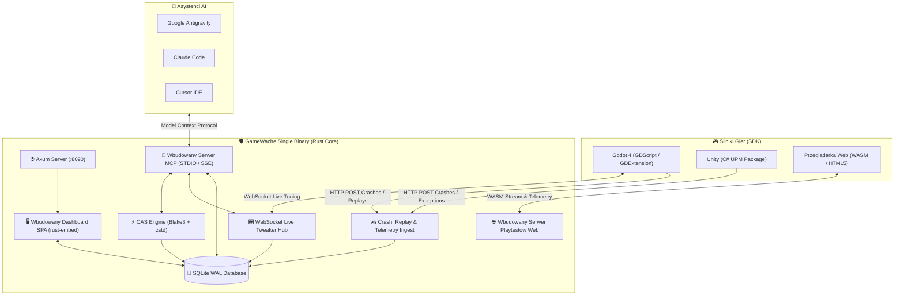

# 🎮 GameWache

<p align="center">
  🌐 <strong>Języki / Languages:</strong>
  <a href="README.md">🇬🇧 English</a> •
  <a href="README.pl.md"><strong>🇵🇱 Polski</strong></a>
</p>

<p align="center">
  <strong>Autonomiczny silnik GameOps dla twórców gier: strażnik awarii, czarna skrzynka wejść (Blackbox Replay), zdalny cache assetów (CAS) i wbudowany serwer MCP dla AI w pojedynczej binarce Rust.</strong><br>
  <em>Fuzja filozofii Nachtwache (obserwowalność, zero zależności, AI Auto-Fix) i Blitzrunner (optymalizacja CI, smart prune, bare-metal runners) stworzona specjalnie dla silników gier (Godot 4, Unity, Unreal, Custom).</em>
</p>

<p align="center">
  <a href="LICENSE"></a>
  
  
  
  
  <a href="https://buymeacoffee.com/adrianwulf"></a>
  <a href="https://github.com/sponsors/adrian-wulf"></a>
</p>

<p align="center">
  
  
  
  
  
  
  
</p>

---

## 📑 Spis Treści
1. [⚡ Dlaczego GameWache?](#-dlaczego-gamewache)
2. [🌐 Ekosystem Adriana Wulfa](#-ekosystem-adriana-wulfa)
3. [📊 Porównanie: Tradycyjne Narzędzia vs GameWache](#-porównanie-tradycyjne-narzędzia-vs-gamewache)
4. [🏗️ Architektura Systemu](#️-architektura-systemu)
5. [🚀 Szybki Start](#-szybki-start)
6. [🤖 Integracja z Agentami AI (Natywny MCP Server)](#-integracja-z-agentami-ai-natywny-mcp-server)
7. [📼 Czarna Skrzynka: Deterministyczny Blackbox Replay](#-czarna-skrzynka-deterministyczny-blackbox-replay)
8. [🎛️ Live Parameter Tweaker & Zdalna Konsola (WebSocket)](#️-live-parameter-tweaker--zdalna-konsola-websocket)
9. [⚡ Shader Stutter Tracker & Pre-warm Generator](#-shader-stutter-tracker--pre-warm-generator)
10. [🧹 Orphan Asset Hunter & Strażnik Budżetów Pamięci](#-orphan-asset-hunter--strażnik-budżetów-pamięci)
11. [🔌 Podłączenie Silnika (Godot 4 & Unity SDK)](#-podłączenie-silnika-godot-4--unity-sdk)
12. [🐳 Wdrożenie Produkcyjne (Docker & Coolify)](#-wdrożenie-produkcyjne-docker--coolify)
13. [⚖️ Licencja & Nota Prawna](#️-licencja--nota-prawna)

---

## ⚡ Dlaczego GameWache?

Klasyczne narzędzia analityczne i chmurowe CI zawodzą w realiach tworzenia gier:
1. **Sentry i BugSplat nie rozumieją specyfiki gier**: Nie rejestrują klatek fizyki (Engine Tick), wejść kontrolera, spadków FPS ani koordynatów przestrzennych `(x, y, z)` na mapie poziomu.
2. **Koszmar reprodukcji błędu**: Sam komunikat `NullReferenceException` nie mówi, co gracz wcisnął 3 sekundy wcześniej. GameWache dołącza deterministyczną **Czarną Skrzynkę (Blackbox Replay)** o zerowym narzucie (<0.02ms/klatkę), pozwalającą odtworzyć awarię klatka po klatce w edytorze silnika.
3. **CI gier jest absurdalnie wolne i drogie**: Importowanie gigabajtów tekstur (ASTC/BC7) i pieczenie assetów w Godot/Unity trwa 30–90 minut na czystych maszynach CI. GameWache udostępnia ultra-szybki **Remote Asset Cache (CAS)** oparty na **Blake3** (>5 GB/s) i **zstd** oraz inteligentny filtr zmian (**Smart Prune**), który pomija import grafiki, gdy modyfikowano tylko kod skryptów.
4. **Agent AI jako asystent QA i Gameplay Designer**: Dzięki wbudowanemu serwerowi **Model Context Protocol (MCP)**, asystenci programistyczni (Antigravity, Cursor, Claude Code) mogą badać crashe, analizować powtórki ruchów gracza, na żywo dostrajać balans fizyki w działającej grze i weryfikować poprawki testami headless.

---

## 🌐 Ekosystem Adriana Wulfa

GameWache jest częścią rodziny niezależnych narzędzi inżynieryjnych tworzonych w duchu **RobinHood dev**:

| Narzędzie | Link | Przeznaczenie |
| :--- | :---: | :--- |
| 🎮 **GameWache** | [GitHub](https://github.com/adrian-wulf/gamewache) | **Autonomiczny GameOps Engine:** Crash Sentinel, Replay Blackbox, Remote CAS i AI MCP Server. |
| 🛡️ **Nachtwache** | [GitHub](https://github.com/adrian-wulf/nachtwache) | **Lekki strażnik błędów:** Drop-in Sentry w pojedynczej binarce Rust (~15 MB RAM) z AI Auto-Fix. |
| ⚡ **BlitzRunner** | [GitHub](https://github.com/adrian-wulf/blitzrunner) | **Optymalizator CI Zero-Server:** Analiza git diff i efemeryczne runnery Hetzner. |
| 🌐 **Wulf Hub** | [social-wulf.eu](https://social-wulf.eu) | **Główny portal ekosystemu:** Portfolio projektów i centrum serwisowe. |

---

## 📊 Porównanie: Tradycyjne Narzędzia vs GameWache

| Cecha / Funkcja | Sentry (SaaS) | GameAnalytics | Unity Accelerator | 🎮 **GameWache** |
| :--- | :---: | :---: | :---: | :---: |
| **Architektura** | 20+ kontenerów (16-32 GB RAM) | Chmura SaaS | Dedykowany serwer | **1 binarka Rust (~9 MB, ~25 MB RAM)** |
| **Baza Danych** | Postgres + ClickHouse + Kafka | N/A | Złożony storage | **Natywne SQLite WAL (zero konfiguracji)** |
| **Blackbox Input Replay** | ❌ Brak | ❌ Brak | ❌ Brak | **✅ Bufor wejść gracza (ostatnie 30-60s)** |
| **Zdalny Cache Assetów (CAS)**| ❌ Brak | ❌ Brak | Płatny Pro/Enterprise | **✅ Wbudowany CAS (Blake3 + zstd)** |
| **Game CI Smart Prune** | ❌ Brak | ❌ Brak | ❌ Brak | **✅ Analiza zmian kodu vs assetów** |
| **Shader Stutter Pre-warm** | ❌ Brak | ❌ Brak | ❌ Brak | **✅ Detekcja hitchy + generator skryptu** |
| **Live Tweaker (WebSocket)** | ❌ Brak | ❌ Brak | ❌ Brak | **✅ Zmiana zmiennych w działającej grze** |
| **Orphan Asset Hunter** | ❌ Brak | ❌ Brak | ❌ Brak | **✅ Wykrywacz niepowiązanych plików w CI** |
| **Prywatny Host Web/WASM** | ❌ Brak | ❌ Brak | ❌ Brak | **✅ Wbudowany serwer z COOP/COEP** |
| **Wbudowany Serwer MCP (AI)**| ❌ Brak | ❌ Brak | ❌ Brak | **✅ Natywny serwer MCP (STDIO & SSE)** |
| **Koszt Licencji** | BSL / Setki $ / miesiąc | Monetyzacja danych | $185+ / stanowisko / mc | **100% Wolny Kod MIT (Zero Opłat)** |

---

## 🏗️ Architektura Systemu



---

## 🚀 Szybki Start

### 1. Pobranie i kompilacja ze źródeł
```bash
git clone https://github.com/adrian-wulf/gamewache.git
cd gamewache
cargo build --release
```

### 2. Uruchomienie serwera i panelu
```bash
./target/release/gamewache serve --port 8090
```
Otwórz przeglądarkę pod adresem **`http://localhost:8090`**, aby zobaczyć wbudowany dashboard.

---

## 🤖 Integracja z Agentami AI (Natywny MCP Server)

GameWache zawiera wbudowany serwer **Model Context Protocol (MCP)**, dzięki czemu narzędzia AI (Antigravity, Cursor, Claude Code) mogą bezpośrednio badać błędy w Twojej grze.

Dodaj konfigurację do swojego pliku konfiguracyjnego MCP (np. `claude_desktop_config.json` lub konfiguracji Cursor / Antigravity):

```json
{
  "mcpServers": {
    "gamewache": {
      "command": "/sciezka/do/gamewache",
      "args": ["mcp", "--project-dir", "/sciezka/do/twojej/gry"]
    }
  }
}
```

### Dostępne narzędzia MCP:
* `gw_query_crashes` — lista ostatnich awarii z filtrami.
* `gw_get_crash_details` — pełny zrzut awarii ze stosem wywołań i kontekstem kodu.
* `gw_inspect_replay` — sekwencja wejść gracza z ostatnich sekund przed błędem.
* `gw_spatial_hotspots` — skupiska punktów awarii/śmierci na wybranej scenie.
* `gw_tweak_runtime_var` — natychmiastowa zmiana zmiennej w działającej grze.
* `gw_exec_console_cmd` — wykonanie polecenia w zdalnej konsoli gry.
* `gw_audit_assets` — skanowanie grafu scen w poszukiwaniu sierocych plików.
* `gw_generate_shader_prewarm` — wygenerowanie skryptu rozgrzewającego shadery.
* `gw_run_headless_tests` — uruchomienie testów GUT/UTF w trybie headless.
* `gw_deploy_web_playtest` — wystawienie buildu HTML5/WASM z linkiem tokenizowanym.

---

## 📼 Czarna Skrzynka: Deterministyczny Blackbox Replay

Bufor kołowy wejść rejestruje w pamięci RAM ostatnie 30–60 sekund rozgrywki:
* **Pamięć**: Zaledwie ~180 KB RAM na 60 sekund historii w 60 FPS.
* **Czas CPU**: Poniżej 0.02 ms na klatkę fizyczną (brak alokacji sterty).
* **Odtwarzanie klatka po klatce**: Załaduj plik powtórki `.gwrec` w edytorze Godot/Unity, zatrzymaj grę na feralnym ticku i podejrzyj wartości węzłów w debuggerze!

---

## 🎛️ Live Parameter Tweaker & Zdalna Konsola (WebSocket)

Błyskawiczne strojenie fizyki czołgu, odrzutu czy prędkości poruszania się bez restartu gry:
1. Zarejestruj zmienną w skrypcie:
   ```gdscript
   GameWache.register_tweak("Movement/DriftFriction", self, "drift_friction", {"min": 0.1, "max": 1.0})
   ```
2. Zmieniaj wartość suwakiem w przeglądarce lub powiedz asystentowi AI w chacie: *„Zwiększ obrót wieżyczki o 20% i sprawdź feeling”* — zmiana następuje natychmiast w otwartym oknie gry!

---

## ⚡ Shader Stutter Tracker & Pre-warm Generator

Wykrywa zacięcia kompilacji potoków graficznych (PSO Hitches) u graczy i jednym poleceniem generuje skrypt wgrzewający shadery podczas ekranu ładowania:
```bash
gamewache prewarm --project-id panzer-hookandshoot --engine godot
```

---

## 🧹 Orphan Asset Hunter & Strażnik Budżetów Pamięci

Analizuje drzewo zależności scen i usuwa gigabajty nieużywanych tekstur oraz plików audio z paczki instalatora:
```bash
gamewache audit --project-dir ./my_game --prune
```

---

## 🔌 Podłączenie Silnika (Godot 4 & Unity SDK)

### Godot 4.x
1. Skopiuj katalog `sdks/godot/addons/gamewache` do folderu `addons/` w Twoim projekcie.
2. Włącz wtyczkę w `Project -> Project Settings -> Plugins`.
3. Gotowe! Klawisz **F11** w grze otwiera nakładkę zgłaszania uwag i błędów z powtórką w tle.

### Unity
1. W Unity Package Managerze wybierz `Add package from disk...` i wskaż `sdks/unity/package.json`.
2. Dodaj komponent `GameWacheClient` do sceny startowej.

---

## 🐳 Wdrożenie Produkcyjne (Docker & Coolify)

GameWache uruchomisz w 1 kliknięcie za pomocą Docker Compose:

```bash
docker compose up -d
```

---

## ⚖️ Licencja & Nota Prawna

Projekt udostępniany jest na warunkach wolnej i otwartej licencji **MIT License**.  
Twórca i autor: **Adrian Wulf** ([social-wulf.eu](https://social-wulf.eu)).
